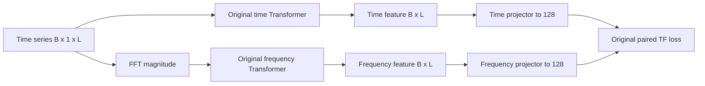
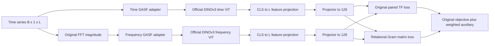

# TF-C + DINOv3 and Relational Consistency

An independent research extension of [TF-C](https://github.com/mims-harvard/TFC-pretraining), adding optional **official DINOv3 backbones** and a configurable auxiliary loss. The original encoder and loss remain available. **No accuracy, F1 or transfer-performance improvement is claimed.**

Original TF-C authors: **Xiang Zhang, Ziyuan Zhao, Theodoros Tsiligkaridis and Marinka Zitnik**. Paper: *Self-Supervised Contrastive Pre-Training for Time Series via Time-Frequency Consistency*, NeurIPS 2022 ([paper](https://arxiv.org/abs/2206.08496)). These fork modifications are distinct from their work. The original README is archived in [docs/UPSTREAM_README.md](docs/UPSTREAM_README.md).

## Provenance

- Fork: [nqming/TFC-DINOv3](https://github.com/nqming/TFC-DINOv3), branch `feature/dinov3-custom-loss`.
- Verified initial fork and fetched upstream/main: `96675826e9ef234a9b01cc63d484c66cb0441bc0`.
- Official DINOv3 source tested: `6876159a11b4df116f30f667f8c9888617df0751` from [facebookresearch/dinov3](https://github.com/facebookresearch/dinov3).
- Original history, author notices and LICENSE remain intact. Source links reference the implementation snapshot; a subsequent documentation-only commit resolves its SHA links.

## Summary of modifications

| Component | Original TF-C | Modified TF-C | Updated file |
|---|---|---|---|
| Encoder | Two independent two-layer Transformers (January 2023 update) | Original option or two official DINOv3 ViTs | `code/TFC/dinov3_encoder.py` |
| Input adapter | `[B,1,L]` directly into Transformer | Separate differentiable GASF images for time and FFT magnitude | `code/TFC/dinov3_encoder.py` |
| Projection | `L -> 256 -> 128`, BatchNorm/ReLU | Same-shaped heads; DINO CLS additionally maps `embed_dim -> L` | `code/TFC/dinov3_encoder.py` |
| Loss | Poly NT-Xent within/across domains | Original plus optional relational consistency | `code/TFC/custom_loss.py`, `code/TFC/trainer.py` |
| Training | Adam; fine-tuning plateau scheduler; model-only checkpoint | Per-batch gradient reset, component logs, optimizer/epoch resume | `code/TFC/trainer.py`, `code/TFC/checkpoint.py` |
| Configuration | Dataset Python configs | Shared JSON overrides | `code/config_files/extension.py`, `configs/*.json` |
| Device | CUDA-only frequency masks | Input-device-aware tensors and explicit CPU selection | `code/TFC/augmentations.py`, `code/TFC/main.py` |

`model.py`, `loss.py`, `dataloader.py` in `code/TFC`, inherited dataset configs, unrelated baselines and LICENSE are unchanged. `DINOv3TFC` reuses `TFC.forward()` and the downstream classifier's `[B,256]` input contract.

## Architecture comparison





Both architectures also process augmented views. Within-domain losses operate on `h_t,h_t_aug` and `h_f,h_f_aug`; auxiliary loss averages original and augmented pairs. Fine-tuning concatenates `z_t,z_f` for the inherited classifier.

The loader retains the first channel, truncates to `TSlength_aligned`, computes `abs(fft(x))`, and returns `(time,label,time_aug,frequency,frequency_aug)`. Frequency perturbation is separate from time jitter. In fine-tuning mode augmented views equal original views. These inherited behaviors are preserved.

### Vision adaptation

Each domain is linearly resampled to S values, centered and divided by RMS with epsilon. Define `u=0.999*tanh(centered/RMS)` and

`G[i,j] = u[i]*u[j] - sqrt(1-u[i]^2)*sqrt(1-u[j]^2)`.

This Gramian Angular Summation Field is mapped to `[0,1]`, repeated across RGB and normalized with official LVD ImageNet mean/std. S must be divisible by 16. GAF follows [Wang and Oates (2015)](https://arxiv.org/abs/1506.00327); tanh/RMS scaling is an explicit adaptation, not their exact preprocessing recipe.

ViT-S/16 returns a 384-dimensional normalized CLS feature, mapped by a trainable linear layer to L. B/16 and L/16 are also selectable. Backbones have independent weights. The loader calls the **unmodified official factory in `dinov3.hub.backbones`**, avoiding eager imports of unrelated task heads in the tested hubconf.py. No substitute Transformer is used.

Normalization discards absolute offset/amplitude; resampling can lose detail; GASF has sign ambiguities. Natural-image pretraining transfer is unverified. The adapter preserves domain separation and sample correspondence, not all original information.

## Custom loss

Let N denote unchanged `NTXentLoss_poly`, with temperature from `Context_Cont`. Its polynomial correction is `CE/(2B)+B*(1/B-pt)`, where pt is the upstream mean of one-hot labels times softmax probabilities across **all matrix entries**. That scaling is preserved.

- Pretraining: `L_TFC=0.2*(N(h_t,h_t_aug)+N(h_f,h_f_aug))+N(z_t,z_f)`.
- Fine-tuning: `L_TFC=CE(classifier([z_t,z_f]),y)+0.1*(N(h_t,h_t_aug)+N(h_f,h_f_aug))+N(z_t,z_f)`.

The upstream `loss_c=sum_k(1+L_TF-L_k)` for three augmented pairings is computed but **not optimized**. This fork retains that behavior.

For row-normalized U=normalize(z_t), V=normalize(z_f):

`R(z_t,z_f)=sum_{i!=j} ((U U^T)[i,j]-(V V^T)[i,j])^2 / (B*(B-1))`

`L_custom=0.5*(R(z_t,z_f)+R(z_t_aug,z_f_aug))`

`L_total=L_TFC+lambda*L_custom`.

B>=2 is batch size, projection dimension is 128, and lambda>=0 is `custom_loss_weight`. The penalty matches inter-sample geometry, complementing paired alignment. It is invariant to orthogonal coordinate changes, uses no teacher/stop-gradient, and costs O(B^2 D). Collapse also minimizes it alone, so it must not replace contrastive loss.

Gradients reach both projectors, feature projections and unfrozen backbones. The GASF is differentiable to input. Frozen backbones remain in eval mode with no parameter gradients; projections remain trainable. Adam includes all parameters, so calling `set_frozen(False)` later needs no new optimizer group. Automatic unfreeze scheduling is not implemented.

Set `custom_loss_enabled: false` or `custom_loss_weight: 0.0` to disable the term. Zero weight returns the exact original loss tensor without computing auxiliary loss. Original-mode training trajectories still change because per-batch gradient clearing is fixed.

## Installation and usage

Run from the fork root. Python 3.12 was tested. PowerShell:

```powershell
python -m venv .venv
.\.venv\Scripts\python.exe -m pip install -r requirements.txt
git clone https://github.com/facebookresearch/dinov3.git ../dinov3-official
git -C ../dinov3-official checkout 6876159a11b4df116f30f667f8c9888617df0751
```

No DINOv3 source/weights are vendored. Requirements are version ranges, not a lockfile; tested versions appear in the report. CUDA needs an appropriate PyTorch build and was unavailable here.

The loader expects tensor dictionaries containing samples/labels at `datasets/SleepEEG/train.pt`, `datasets/Epilepsy/train.pt`, `datasets/Epilepsy/test.pt`. It loads target files even during pretraining. No datasets were downloaded here. See the archived README for data setup. These dataset-scale commands are **not tested with real data**:

```powershell
# Original encoder/loss
.\.venv\Scripts\python.exe code/TFC/main.py --training_mode pre_train --device cpu --config configs/original.json --run_description original
# Official DINOv3, random initialization and auxiliary loss
.\.venv\Scripts\python.exe code/TFC/main.py --training_mode pre_train --device cpu --config configs/dinov3.json --run_description dinov3
```

DINOv3 JSON defaults to `dinov3_pretrained: false`, `dinov3_freeze: false`. For authorized pretrained LVD weights, set pretrained true, set `dinov3_weights` to a local checkpoint path, and optionally freeze true. JSON paths resolve relative to current working directory. Obtain weights through the [official access process](https://github.com/facebookresearch/dinov3#pretrained-models). Missing weights raise an error without random fallback. Released weights are **not tested** here. Adapter normalization targets LVD, not SAT weights.

For ablations, edit `custom_loss_enabled`/`custom_loss_weight` in a copy of either JSON. Other overrides: batch_size, target_batch_size, num_epoch, lr. Resume uses num_epoch as total epoch target. Training batches need at least two samples. Use distinct run descriptions for ablations. `--subset` enables the inherited debug subset.

```powershell
# Resume the example DINOv3 run
.\.venv\Scripts\python.exe code/TFC/main.py --training_mode pre_train --device cpu --config configs/dinov3.json --run_description dinov3 --resume ../experiments_logs/SleepEEG_2_Epilepsy/dinov3/pre_train_seed_42_dinov3/saved_models/ckp_last.pt
# Fine-tune matching architecture/checkpoint
.\.venv\Scripts\python.exe code/TFC/main.py --training_mode fine_tune_test --device cpu --config configs/dinov3.json --run_description dinov3 --checkpoint ../experiments_logs/SleepEEG_2_Epilepsy/dinov3/pre_train_seed_42_dinov3/saved_models/ckp_last.pt
# Tests using actual official backbone, random weights
$env:DINOV3_REPO=(Resolve-Path ../dinov3-official).Path
.\.venv\Scripts\python.exe -m pytest tests -q
```

Without DINOV3_REPO, integration tests skip explicitly. Set DINOV3_WEIGHTS to enable the optional pretrained test. Synthetic tensors remain in temporary folders. CLI tests exercise both encoders at image size 32 and resume epoch 1 to 2; a separate test exercises 224-pixel forward and unfrozen backward at 32. Long training/full-resolution backward are untested.

Checkpoints include model/optimizer/epoch/config metadata. Legacy model_state_dict and raw state dictionaries load strictly into matching original models. Weight-only files cannot resume optimizers. Resume does not restore RNG/cached augmentations and is **not bitwise replay**. Fine-tuning saves run-local model/classifier weights; fine-tuning optimizer/scheduler resume is unsupported.

## Test results

Recorded 2026-10-29: **19 passed, 2 skipped in 36.30s**. Windows, Python 3.12.14, PyTorch 2.15.0+cpu. Synthetic tests validate mechanics, not representation quality.

| Test | Status | Notes |
|---|---|---|
| Original TF-C | PASS | Init, exact eval parity with baseline source, original loss/backward, legacy checkpoint |
| DINOv3 forward | PASS | Official ViT-S/16, independent branches, 32/224 pixels, random weights |
| DINOv3 backward | PASS | Both unfrozen patch embeddings get finite nonzero gradients; frozen backbones gradient-free |
| Custom loss | PASS | Mathematical reference, backward, constant features, dimension/NaN/Inf guards, zero/disabled paths |
| Training step | PASS | Both encoders pretrain, original fine-tuning, optimizer coverage |
| Checkpoints | PASS | Original/DINO state/optimizer round trips, mismatch rejection |
| CLI + resume | PASS | Both encoders via main.py, temporary synthetic data, epoch 1 to 2 |
| Pretrained DINOv3 | SKIP | Authorized checkpoint absent |
| CUDA | SKIP | CPU-only runtime |
| Real-data benchmarks | NOT RUN | No accuracy/F1 or superiority claims |

Warnings reflect preserved Transformer layout, NumPy/PyTorch jitter interoperability and undefined metrics on tiny synthetic batches. Printed synthetic classifier scores are not research results.

## Detailed code changes

Every new/modified tracked file follows. Ranges derive from actual source and Python AST; report includes exact diff hunks. Documentation links reference the implementation snapshot before final SHA substitution.

### `.gitignore`

Original behavior: Cache/data ignores.

Modified behavior: Adds virtualenv, pytest cache, weight formats and logs.

Reason: Keep local dependencies and large weights out of Git.

Updated file: [L1-L14](https://github.com/nqming/TFC-DINOv3/blob/CODE_COMMIT_SHA/.gitignore#L1-L14).

Classes/functions: not applicable (configuration/documentation).

### `code/TFC/augmentations.py`

Original behavior: CUDA allocations in remove_frequency/add_frequency.

Modified behavior: Uses rand_like on input device.

Reason: Enable CPU/CUDA-compatible frequency augmentation.

Updated file: [L1-L133](https://github.com/nqming/TFC-DINOv3/blob/CODE_COMMIT_SHA/code/TFC/augmentations.py#L1-L133).

Classes/functions:

- `remove_frequency`: [L60-L63](https://github.com/nqming/TFC-DINOv3/blob/CODE_COMMIT_SHA/code/TFC/augmentations.py#L60-L63)
- `add_frequency`: [L65-L72](https://github.com/nqming/TFC-DINOv3/blob/CODE_COMMIT_SHA/code/TFC/augmentations.py#L65-L72)

### `code/TFC/main.py`

Original behavior: Direct TFC construction, implicit device, relative data paths, weight-only load.

Modified behavior: Config/factory, explicit device, data root, loss logs, encoder run paths and resume; subset becomes opt-in.

Reason: Expose extensions through the existing CLI.

Updated file: [L1-L135](https://github.com/nqming/TFC-DINOv3/blob/CODE_COMMIT_SHA/code/TFC/main.py#L1-L135).

Classes/functions:

Module-level execution; no classes/functions.

### `code/TFC/trainer.py`

Original behavior: Original objective; gradient reset once per epoch; final weight-only checkpoint; global fine-tuning paths.

Modified behavior: Optional custom loss, finite checks/logging, per-batch zero_grad, actual batch size, epoch checkpoints, run-local fine-tuning paths, modern NumPy and class-count handling.

Reason: Preserve objective while fixing training/device/checkpoint issues.

Updated file: [L1-L330](https://github.com/nqming/TFC-DINOv3/blob/CODE_COMMIT_SHA/code/TFC/trainer.py#L1-L330).

Classes/functions:

- `Trainer`: [L20-L110](https://github.com/nqming/TFC-DINOv3/blob/CODE_COMMIT_SHA/code/TFC/trainer.py#L20-L110)
- `model_pretrain`: [L112-L161](https://github.com/nqming/TFC-DINOv3/blob/CODE_COMMIT_SHA/code/TFC/trainer.py#L112-L161)
- `model_finetune`: [L164-L258](https://github.com/nqming/TFC-DINOv3/blob/CODE_COMMIT_SHA/code/TFC/trainer.py#L164-L258)
- `model_test`: [L261-L330](https://github.com/nqming/TFC-DINOv3/blob/CODE_COMMIT_SHA/code/TFC/trainer.py#L261-L330)

### `code/TFC/dinov3_encoder.py`

Original behavior: No vision encoder.

Modified behavior: GramianAdapter, DINOv3Encoder, DINOv3TFC and build_model with official factories and independent domain backbones.

Reason: Bridge one-dimensional views to DINOv3 while retaining original forward/projection contract.

Updated file: [L1-L111](https://github.com/nqming/TFC-DINOv3/blob/CODE_COMMIT_SHA/code/TFC/dinov3_encoder.py#L1-L111).

Classes/functions:

- `GramianAdapter`: [L12-L35](https://github.com/nqming/TFC-DINOv3/blob/CODE_COMMIT_SHA/code/TFC/dinov3_encoder.py#L12-L35)
- `GramianAdapter.__init__`: [L15-L21](https://github.com/nqming/TFC-DINOv3/blob/CODE_COMMIT_SHA/code/TFC/dinov3_encoder.py#L15-L21)
- `GramianAdapter.forward`: [L23-L35](https://github.com/nqming/TFC-DINOv3/blob/CODE_COMMIT_SHA/code/TFC/dinov3_encoder.py#L23-L35)
- `DINOv3Encoder`: [L38-L84](https://github.com/nqming/TFC-DINOv3/blob/CODE_COMMIT_SHA/code/TFC/dinov3_encoder.py#L38-L84)
- `DINOv3Encoder.__init__`: [L41-L68](https://github.com/nqming/TFC-DINOv3/blob/CODE_COMMIT_SHA/code/TFC/dinov3_encoder.py#L41-L68)
- `DINOv3Encoder.set_frozen`: [L70-L73](https://github.com/nqming/TFC-DINOv3/blob/CODE_COMMIT_SHA/code/TFC/dinov3_encoder.py#L70-L73)
- `DINOv3Encoder.train`: [L75-L79](https://github.com/nqming/TFC-DINOv3/blob/CODE_COMMIT_SHA/code/TFC/dinov3_encoder.py#L75-L79)
- `DINOv3Encoder.forward`: [L81-L84](https://github.com/nqming/TFC-DINOv3/blob/CODE_COMMIT_SHA/code/TFC/dinov3_encoder.py#L81-L84)
- `DINOv3TFC`: [L87-L100](https://github.com/nqming/TFC-DINOv3/blob/CODE_COMMIT_SHA/code/TFC/dinov3_encoder.py#L87-L100)
- `DINOv3TFC.__init__`: [L90-L95](https://github.com/nqming/TFC-DINOv3/blob/CODE_COMMIT_SHA/code/TFC/dinov3_encoder.py#L90-L95)
- `DINOv3TFC._projector`: [L98-L100](https://github.com/nqming/TFC-DINOv3/blob/CODE_COMMIT_SHA/code/TFC/dinov3_encoder.py#L98-L100)
- `build_model`: [L103-L111](https://github.com/nqming/TFC-DINOv3/blob/CODE_COMMIT_SHA/code/TFC/dinov3_encoder.py#L103-L111)

### `code/TFC/custom_loss.py`

Original behavior: No auxiliary relational objective.

Modified behavior: RelationalConsistencyLoss and add_custom_loss with validation/zero-weight bypass.

Reason: Align inter-sample geometry without replacing paired contrastive learning.

Updated file: [L1-L31](https://github.com/nqming/TFC-DINOv3/blob/CODE_COMMIT_SHA/code/TFC/custom_loss.py#L1-L31).

Classes/functions:

- `RelationalConsistencyLoss`: [L8-L20](https://github.com/nqming/TFC-DINOv3/blob/CODE_COMMIT_SHA/code/TFC/custom_loss.py#L8-L20)
- `RelationalConsistencyLoss.forward`: [L11-L20](https://github.com/nqming/TFC-DINOv3/blob/CODE_COMMIT_SHA/code/TFC/custom_loss.py#L11-L20)
- `add_custom_loss`: [L23-L31](https://github.com/nqming/TFC-DINOv3/blob/CODE_COMMIT_SHA/code/TFC/custom_loss.py#L23-L31)

### `code/TFC/checkpoint.py`

Original behavior: Inline weight-only checkpoints.

Modified behavior: save_checkpoint/load_checkpoint with metadata, optimizer, epoch and strict legacy loading.

Reason: Resume pretraining and reject incompatible configurations.

Updated file: [L1-L25](https://github.com/nqming/TFC-DINOv3/blob/CODE_COMMIT_SHA/code/TFC/checkpoint.py#L1-L25).

Classes/functions:

- `save_checkpoint`: [L6-L11](https://github.com/nqming/TFC-DINOv3/blob/CODE_COMMIT_SHA/code/TFC/checkpoint.py#L6-L11)
- `load_checkpoint`: [L14-L25](https://github.com/nqming/TFC-DINOv3/blob/CODE_COMMIT_SHA/code/TFC/checkpoint.py#L14-L25)

### `code/config_files/extension.py`

Original behavior: Dataset Python configs only.

Modified behavior: DEFAULTS/configure and validated JSON overrides.

Reason: Share extension controls without modifying inherited dataset configs.

Updated file: [L1-L31](https://github.com/nqming/TFC-DINOv3/blob/CODE_COMMIT_SHA/code/config_files/extension.py#L1-L31).

Classes/functions:

- `configure`: [L13-L31](https://github.com/nqming/TFC-DINOv3/blob/CODE_COMMIT_SHA/code/config_files/extension.py#L13-L31)

### `configs/original.json`

Original behavior: Absent.

Modified behavior: Original encoder with custom loss disabled.

Reason: Explicit original-mode recipe.

Updated file: [L1-L1](https://github.com/nqming/TFC-DINOv3/blob/CODE_COMMIT_SHA/configs/original.json#L1-L1).

Classes/functions: not applicable (configuration/documentation).

### `configs/dinov3.json`

Original behavior: Absent.

Modified behavior: ViT-S/16, 224-pixel GASF, random unfrozen weights, batch 8, auxiliary weight 0.1.

Reason: Explicit no-download starting recipe.

Updated file: [L1-L12](https://github.com/nqming/TFC-DINOv3/blob/CODE_COMMIT_SHA/configs/dinov3.json#L1-L12).

Classes/functions: not applicable (configuration/documentation).

### `requirements.txt`

Original behavior: Legacy baseline conda environments only.

Modified behavior: Modern TF-C/pytest dependency ranges.

Reason: Install extension without changing unrelated baseline environments.

Updated file: [L1-L6](https://github.com/nqming/TFC-DINOv3/blob/CODE_COMMIT_SHA/requirements.txt#L1-L6).

Classes/functions: not applicable (configuration/documentation).

### `tests/conftest.py`

Original behavior: Absent.

Modified behavior: Root import paths and two CPU threads.

Reason: Run repository-root tests with bounded CPU overhead.

Updated file: [L1-L8](https://github.com/nqming/TFC-DINOv3/blob/CODE_COMMIT_SHA/tests/conftest.py#L1-L8).

Classes/functions:

Module-level execution; no classes/functions.

### `tests/test_extensions.py`

Original behavior: No extension regression suite.

Modified behavior: Original parity, loss math/gradients, actual DINOv3, freeze/unfreeze, checkpoint, CLI/resume and explicit skips.

Reason: Validate mechanics without claiming benchmark performance.

Updated file: [L1-L262](https://github.com/nqming/TFC-DINOv3/blob/CODE_COMMIT_SHA/tests/test_extensions.py#L1-L262).

Classes/functions:

- `config`: [L25-L32](https://github.com/nqming/TFC-DINOv3/blob/CODE_COMMIT_SHA/tests/test_extensions.py#L25-L32)
- `loader`: [L35-L37](https://github.com/nqming/TFC-DINOv3/blob/CODE_COMMIT_SHA/tests/test_extensions.py#L35-L37)
- `test_original_matches_upstream_and_checkpoint`: [L40-L59](https://github.com/nqming/TFC-DINOv3/blob/CODE_COMMIT_SHA/tests/test_extensions.py#L40-L59)
- `test_adapter_shape_and_gradient`: [L63-L68](https://github.com/nqming/TFC-DINOv3/blob/CODE_COMMIT_SHA/tests/test_extensions.py#L63-L68)
- `test_adapter_rejects_invalid`: [L72-L74](https://github.com/nqming/TFC-DINOv3/blob/CODE_COMMIT_SHA/tests/test_extensions.py#L72-L74)
- `test_relational_math_backward`: [L77-L90](https://github.com/nqming/TFC-DINOv3/blob/CODE_COMMIT_SHA/tests/test_extensions.py#L77-L90)
- `test_loss_dimensions`: [L94-L96](https://github.com/nqming/TFC-DINOv3/blob/CODE_COMMIT_SHA/tests/test_extensions.py#L94-L96)
- `test_loss_rejects_nonfinite`: [L100-L102](https://github.com/nqming/TFC-DINOv3/blob/CODE_COMMIT_SHA/tests/test_extensions.py#L100-L102)
- `test_weight_and_zero_equivalence`: [L106-L118](https://github.com/nqming/TFC-DINOv3/blob/CODE_COMMIT_SHA/tests/test_extensions.py#L106-L118)
- `test_original_training_checkpoint_and_resume`: [L121-L140](https://github.com/nqming/TFC-DINOv3/blob/CODE_COMMIT_SHA/tests/test_extensions.py#L121-L140)
- `test_finetune_step`: [L143-L150](https://github.com/nqming/TFC-DINOv3/blob/CODE_COMMIT_SHA/tests/test_extensions.py#L143-L150)
- `test_trainer_saves_epoch_checkpoint`: [L153-L162](https://github.com/nqming/TFC-DINOv3/blob/CODE_COMMIT_SHA/tests/test_extensions.py#L153-L162)
- `dino_config`: [L166-L173](https://github.com/nqming/TFC-DINOv3/blob/CODE_COMMIT_SHA/tests/test_extensions.py#L166-L173)
- `test_real_dinov3_forward_freeze_unfreeze_training`: [L176-L206](https://github.com/nqming/TFC-DINOv3/blob/CODE_COMMIT_SHA/tests/test_extensions.py#L176-L206)
- `test_pretrained_checkpoint`: [L209-L217](https://github.com/nqming/TFC-DINOv3/blob/CODE_COMMIT_SHA/tests/test_extensions.py#L209-L217)
- `test_cuda_adapter_loss`: [L220-L226](https://github.com/nqming/TFC-DINOv3/blob/CODE_COMMIT_SHA/tests/test_extensions.py#L220-L226)
- `test_cli_pretraining_and_resume`: [L230-L262](https://github.com/nqming/TFC-DINOv3/blob/CODE_COMMIT_SHA/tests/test_extensions.py#L230-L262)

### `docs/UPSTREAM_README.md`

Original behavior: Original root README.

Modified behavior: Exact content archive; relative links keep their historical root-relative context.

Reason: Preserve attribution and original usage history.

Updated file: [L1-L192](https://github.com/nqming/TFC-DINOv3/blob/CODE_COMMIT_SHA/docs/UPSTREAM_README.md#L1-L192).

Classes/functions: not applicable (configuration/documentation).

### `README.md`

Original behavior: Paper-focused upstream README.

Modified behavior: Extension architecture, equations, usage, tests and source map.

Reason: Make modifications auditable.

Updated file: [L1-L424](https://github.com/nqming/TFC-DINOv3/blob/CODE_COMMIT_SHA/README.md#L1-L424).

Classes/functions: not applicable (configuration/documentation).

### `docs/MODIFICATION_REPORT.md`

Original behavior: Absent.

Modified behavior: Architecture analysis, before/after map, exact diff hunks, tests, limitations and future work.

Reason: Record engineering decisions and evidence.

Updated file: [L1-L147](https://github.com/nqming/TFC-DINOv3/blob/CODE_COMMIT_SHA/docs/MODIFICATION_REPORT.md#L1-L147).

Classes/functions: not applicable (configuration/documentation).


## Attribution and license

Original [MIT LICENSE](LICENSE), copyright **2022 Machine Learning for Medicine and Science @ Harvard**, notices and Git history remain intact. This fork does not claim authorship of inherited code.

DINOv3 is Meta AI/FAIR's work ([paper](https://arxiv.org/abs/2508.10104)), under the separate [DINOv3 License](https://github.com/facebookresearch/dinov3/blob/6876159a11b4df116f30f667f8c9888617df0751/LICENSE.md). It is not relicensed under TF-C's MIT license. No checkpoints are committed.

```bibtex
@inproceedings{zhang2022self,
  title={Self-Supervised Contrastive Pre-Training for Time Series via Time-Frequency Consistency},
  author={Zhang, Xiang and Zhao, Ziyuan and Tsiligkaridis, Theodoros and Zitnik, Marinka},
  booktitle={Advances in Neural Information Processing Systems},
  year={2022}
}
```

See [docs/MODIFICATION_REPORT.md](docs/MODIFICATION_REPORT.md) for original analysis, comparisons, limitations and future experiments.
